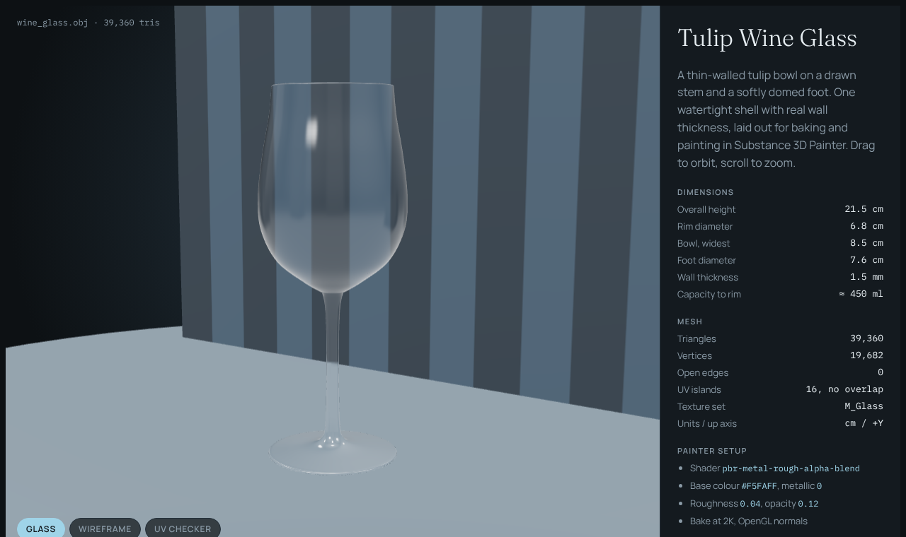

# Tulip Wine Glass: 3D asset for Substance 3D Painter



A thin-walled tulip wine glass: one watertight shell with real wall thickness
(outer bowl, rounded rim bead, inner bowl, drawn stem, domed foot), UV-unwrapped
for baking and painting.

| Spec | Value |
|---|---|
| Overall height | 21.5 cm |
| Rim / widest bowl / foot diameter | 6.8 / 8.5 / 7.6 cm |
| Wall thickness | 1.5 mm |
| Capacity to rim | ≈ 450 ml |
| Triangles / vertices | 39,360 / 19,682 |
| Open edges / non-manifold edges | 0 / 0 |
| UV islands | 16, in 0–1, no overlaps, uniform texel density |
| Material / texture set | `M_Glass` (one texture set) |
| Units / up axis | centimetres / +Y |

## Files

| Path | What it is |
|---|---|
| `mesh/wine_glass.obj` + `.mtl` | The model to import into Substance Painter |
| `substance_painter/create_glass_spp.py` | Builds and saves `wine_glass.spp` inside Painter |
| `preview/index.html` | Interactive three.js preview (glass / wireframe / UV checker) |
| `preview/uv_layout.png` | UV layout at 2048 px |
| `tools/generate_glass.py` | Regenerates the mesh (edit the profile points to change the shape) |
| `tools/validate_mesh.py` | Checks watertightness and UV overlap, draws the UV layout |

## Getting the `.spp` file

A `.spp` is Substance Painter's own binary project format; only Painter can write
it. The script below creates the full project from the mesh and saves it as
`substance_painter/wine_glass.spp`:

1. Open Substance 3D Painter (8.3 or later).
2. Open **Python > Python console** (or put the script in your Python plugins folder).
3. Run:
   ```python
   exec(open(r"C:/path/to/repo/glass/substance_painter/create_glass_spp.py").read())
   ```

The script:
- creates the project from `mesh/wine_glass.obj` at 2K with OpenGL normals,
  using the **PBR - Metallic Roughness Alpha-blend** template when it can find it;
- adds an **Opacity** channel;
- creates three fill layers: *Clear Glass* (on), *Rim Frost* and *Fingerprints*
  (off, with black masks ready to paint);
- saves `wine_glass.spp`.

### Manual setup (if you prefer, or the script hits an API difference)

1. **File > New**, select `wine_glass.obj`, template *PBR - Metallic Roughness Alpha-blend*,
   resolution 2048, normal map format OpenGL.
2. **Texture Set Settings > Channels > +** and add **Opacity**.
3. **Shader Settings**: shader `pbr-metal-rough-alpha-blend`.
4. **Bake Mesh Maps** (Ambient Occlusion, Curvature, Thickness, Position, World Space Normal).
   Use the mesh itself as the high poly; it is already smooth.
5. Add a fill layer with these values:

| Channel | Value |
|---|---|
| Base colour | `#F5FAFF` (0.96, 0.98, 1.00) |
| Metallic | 0 |
| Roughness | 0.04 |
| Opacity | 0.12 |

Ideas for detail layers: a curvature-masked frost on the rim and foot edge,
a fingerprint grunge on the bowl (roughness 0.5, opacity +0.1), or a tinted
colour for coloured glass.

### Exporting for real-time or offline rendering

Painter's viewport only fakes transparency. For final renders, export the maps
(**File > Export Textures**, preset *PBR Metallic Roughness*) and use a real glass
material in your renderer: transmission 1, IOR 1.5, and the exported roughness map,
with the opacity map driving frosted or smudged areas.

## Regenerate

```bash
python3 glass/tools/generate_glass.py
python3 glass/tools/validate_mesh.py glass/mesh/wine_glass.obj glass/preview/uv_layout.png
```
